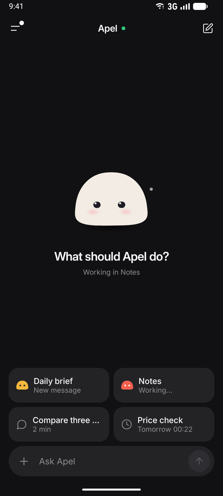
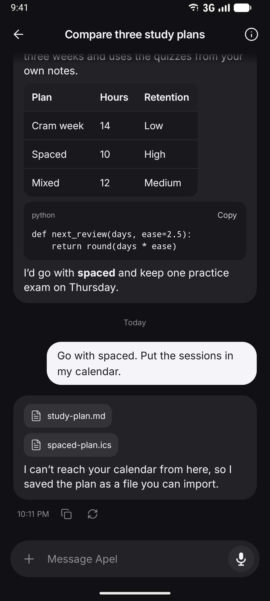
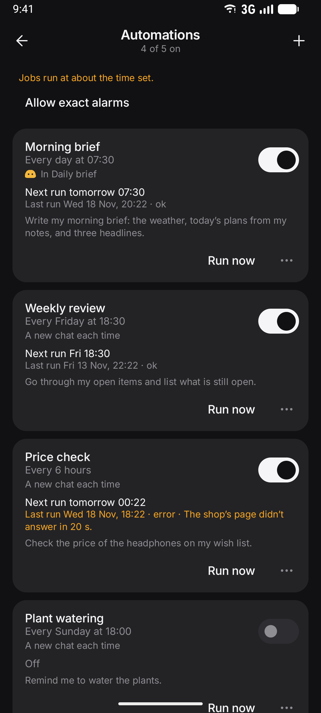
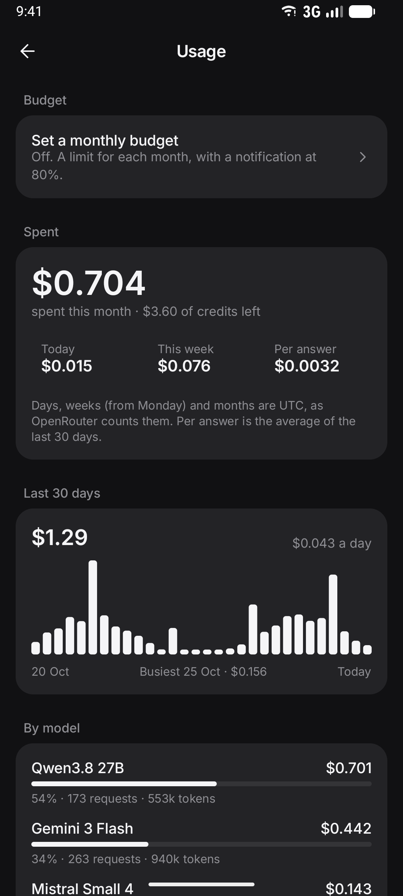

<p align="center">
  
</p>

<h1 align="center">Apel</h1>

<p align="center">
  <b>Your own AI agent, on your phone.</b><br>
  Chats, agents, files, databases and scheduled jobs that live on your Android phone,<br>
  with the AI provider you choose. No server, no account with us, no telemetry.
</p>

<p align="center">
  <a href="https://github.com/erkanw/apel/releases/latest">Download the latest APK</a> ·
  <a href="CHANGELOG.md">What’s new</a> ·
  <a href="PRIVACY.md">Privacy</a>
</p>

<p align="center">
  
  
  
  
</p>

## What is Apel?

Apel is an AI agent that runs on your phone instead of in someone’s cloud. It can do more than chat: it searches
and reads the web, keeps notes and files, fills databases, remembers what matters to you, and runs jobs on a schedule,
such as a morning brief, while the screen is off.

You bring the AI model. Sign in to [OpenRouter](https://openrouter.ai) (hundreds of models with one account, free
models included) or connect any OpenAI-compatible server, such as Groq or your own. You pay the provider directly, only
for what you use; Apel itself is free and open source.

## Features

- **Agents for different jobs.** Make a study companion, a researcher, a training coach or your own. Each has its own
  name, look, model, instructions and memory, and only the tools, skills and databases you allow it. A chat keeps the
  agent it started with, and every answer says which agent wrote it.
- **Agents that work together.** An agent can ask your other agents what they know, and hand a big task (such as
  reading many pages to compare prices) to a subagent with a fresh chat, so its own chat stays short. Each asks you
  first, and each agent has its own switches for both.
- **Chat that shows its work.** Answers stream in with the steps behind them (searches, files read, tools used).
  Attach pictures, PDFs and text files, dictate, edit a message and ask again.
- **Channels** keep chats on one subject together, each with its own colour and agent.
- **Files and databases.** The agent has its own folder and SQLite databases on the phone. You can browse and edit
  them, import and export CSV, or just describe what you want to track and let the agent set it up.
- **Automations** run a prompt on a schedule and post the answer in a chat or channel. Turn on Keep running in the
  background and they start on time even after you close the app.
- **Tools and skills.** Web search, web pages, files, databases, memory, notifications, an experimental browser, and
  remote tool servers (MCP over HTTP). Each tool is allowed, asks first, or is off; "Allow and don’t ask again" lets
  requests like one you approved run without asking. Skills are instructions the agent follows for tasks you repeat.
- **Usage and budget.** See what each model, agent and automation cost, and set a monthly limit.
- **A mascot you shape yourself.** A soft blob whose shape, colour and finish you choose, on Home and on a home-screen
  widget.
- **Backup and restore** of everything except keys, in one zip file.

## Get started

1. Download the APK from the [latest release](https://github.com/erkanw/apel/releases/latest) and open it on
   your phone (Android 10 or newer). Android asks once to allow installs from your browser or file manager.
2. Open Apel and follow the welcome: connect a provider, pick a first model, tell it your name, and give your agent a
   name and a look. A short walkthrough of the app follows.
3. Ask it something.

Free models on OpenRouter cost nothing within their daily limits, but they are slower and fail more often on long
tasks. A paid model costs a fraction of a cent to a few cents per answer; the Usage page shows exactly what you spent.

## Privacy

Your chats, files, databases and memory stay on the phone. Apel only connects to the AI provider you chose, to web pages
when the agent reads or searches them, and to tool servers you add. Keys are kept in the Android Keystore. By default,
OpenRouter only routes to providers that don’t keep your data. There are no analytics, no ads and no account. The full
statement is in [PRIVACY.md](PRIVACY.md) and in the app (Settings → About).

## Status

Apel is young. The latest release is **0.3.0**: agents that work together, running in the background for
automations, and fewer approvals to tap. **0.2.1** and **0.2.2** fixed the security problems found in an outside
review ([GHSA-hxqm-jrhr-f2fw](https://github.com/erkanw/apel/security/advisories/GHSA-hxqm-jrhr-f2fw),
[GHSA-jr23-87jf-9x8j](https://github.com/erkanw/apel/security/advisories/GHSA-jr23-87jf-9x8j)), so update if you
use an older one. **0.2.0** added agents, **0.1.0** was the first release. Releases are signed APKs here on GitHub;
F-Droid is planned. There is no iPhone version. See the [changelog](CHANGELOG.md) for what changed.

Found a bug or have an idea? [Open an issue](https://github.com/erkanw/apel/issues). In the app, Settings → About →
“Copy diagnostics” gives a short report without any of your content that you can paste into it. Found a security
problem? Please don’t open an issue: report it privately with
[Report a vulnerability](https://github.com/erkanw/apel/security/advisories/new).

## Build it yourself

You need JDK 21 and the Android SDK (compileSdk 35).

```
./gradlew :app:assembleDebug :app:testDebugUnitTest
```

The debug APK is in `app/build/outputs/apk/debug/`. To see every screen without a provider, turn on demo mode in a
debug build and restart the app:

```
adb shell run-as io.github.erkanw.vault touch files/demo
```

Write `busy`, `error` or `empty` into that file for those states; delete it to turn demo mode off. Release builds have no
demo data. `./gradlew :app:assembleRelease` makes an unsigned release APK, as F-Droid builds it; it is signed when a
gitignored `keystore.properties` (`storeFile`, `storePassword`, `keyAlias`, `keyPassword`) sits next to
`settings.gradle.kts`.

Debug builds also have three galleries for design review: `KitGalleryActivity` (components), `MascotGalleryActivity`
(the mascot’s states) and `WidgetGalleryActivity` (the widgets).

<details>
<summary>Where things are in the code</summary>

```
app/src/main/kotlin/io/github/erkanw/vault/
  MainActivity, AppGraph       the activity, and the one place long-lived parts are built
  ChatViewModel                chat, sessions, channels, composer, dictation
  PagesViewModel               Files, Skills, Automations, Tools
  AgentsViewModel              the agents and each agent's page
  SettingsViewModel            appearance, notifications, widget, models, backup
  agent/                       the agent loop, prompts, and what the screens ask of it
  automation/                  scheduled jobs and the nightly memory tidy
  chat/                        chat models and pure helpers (sessions, channels, attachments, markdown, commands)
  mascot/                      the blob: shapes, engine, painter, flat icons, states
  tools/                       the agent's tools
  ui/                          the screens and the component kit
  widget/                      the mascot widget and the usage widget
  openrouter/, provider/       the OpenRouter catalogue and sign-in, and your own server
  store/                       the database, agents, profile, backup and diagnostics
  userdb/, usage/              your databases, and what each answer cost
app/src/debug/                 demo mode (DemoBackend), galleries
fastlane/metadata/android/     the F-Droid listing (descriptions, changelogs, screenshots)
```

The design system is in [DESIGN.md](DESIGN.md). The code’s package
is `io.github.erkanw.vault`, after the project’s working name.

</details>

## Licence

Apache License 2.0, see [LICENSE](LICENSE) and [NOTICE](NOTICE). The mascot is a port of
[Blob Atelier](https://github.com/victoriawu-77/blob-atelier) by Victoria Wu (MIT). It and the other third-party
material (Inter, Lucide, the AndroidX, Kotlin and OkHttp libraries) are listed in [THIRD_PARTY.md](THIRD_PARTY.md), with
their licences in `licenses/`.
